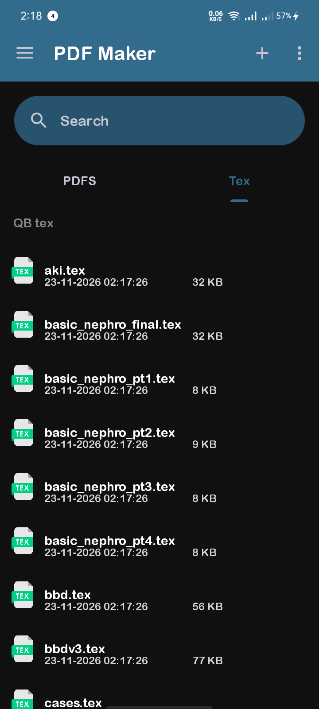
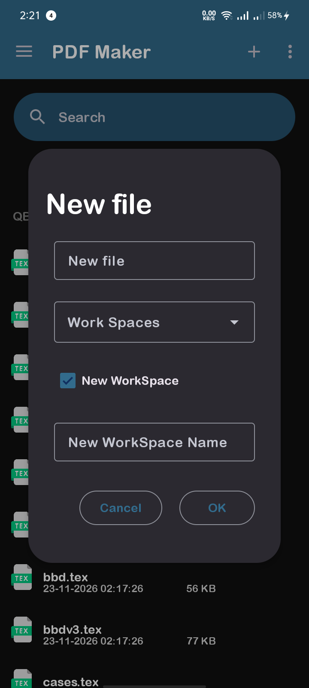
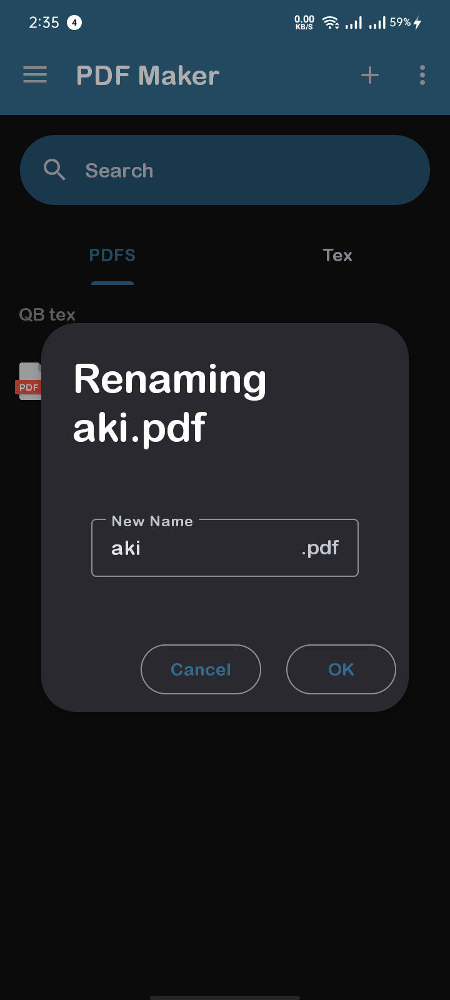
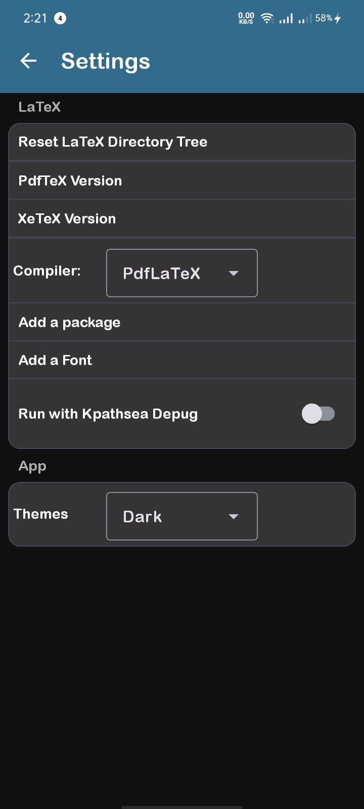
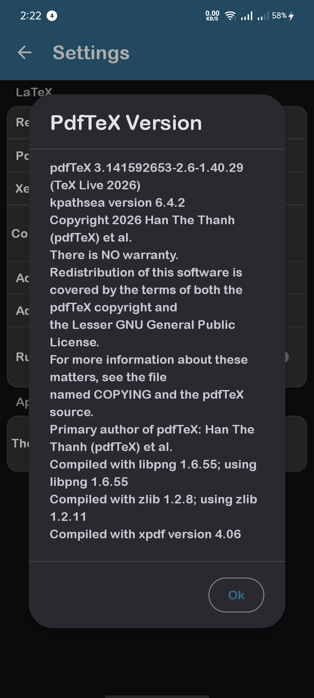
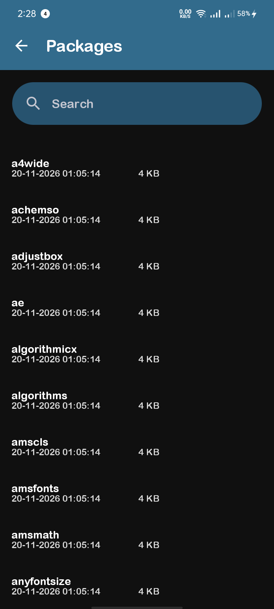

# PDF Maker

An offline Android LaTeX IDE and PDF compiler powered by **pdfTeX (TeX Live 2026)**, with an integrated **Xed-Editor** (built on **Sora Editor**) for `.tex` editing, workspace management, and local PDF generation.

## Overview

PDF Maker brings a self-contained TeX Live setup to Android, so you can write, compile, debug, and preview LaTeX documents without an internet connection.

PDF Maker keeps strict ownership of its internal database and workspace structure. Xed-Editor and Sora Editor are bundled for rich code editing and log inspection, but their file-system features are intentionally limited to **editing and saving the active file**. This prevents file-tree conflicts and keeps workspace tracking in one place.

## Key Features

- **Offline LaTeX compilation:** built-in `pdfLaTeX` running natively on Android (pdfTeX 3.141592653, TeX Live 2026, kpathsea 6.4.2).
- **Workspaces and file management:** organize `.tex` sources and compiled `.pdf` outputs into workspaces (for example `QB tex`), with search, rename, compile, and delete actions.
- **Bundled, scoped editor:** Xed-Editor + Sora Editor for syntax-highlighted `.tex` editing and build-log inspection.
- **Package and font management:** browse pre-installed TeX packages (`amsmath`, `tikz`, `tcolorbox`, `adjustbox`, and more), or import custom `.sty` packages and fonts into the local TeX tree.
- **Compilation logs and debugging:** inspect full outputs (`aki.log`, `aki_output.log`), toggle **Kpathsea Debug** mode, or reset the TeX directory tree from Settings.
- **PDF viewing and sharing:** open compiled PDFs inside the app or share them with external viewers.
## Screenshots

### Workspace, compilation, and PDF output

| Workspace & `.tex` files | Create file & workspace | Rename / file actions |
| :---: | :---: | :---: |
|  |  |  |

### TeX engine, packages, and settings

| Compiler & app settings | Bundled pdfTeX / TeX Live info | Installed LaTeX packages |
| :---: | :---: | :---: |
|  |  |  |

## Demo

[Watch the full app demo (media/Record.mp4)](media/Record.mp4)

Workflow shown:

1. Select a `.tex` file from the workspace (`aki.tex`) and tap **Compile**.
2. Switch to the **PDFS** tab to see the generated `aki.pdf` (166 KB).
3. Open and preview the rendered multi-page PDF.
4. Open the navigation drawer, choose **Logs**, and inspect `aki_output.log` in the bundled editor.
## Architecture

```text
├── app/           # Main PDF Maker app (UI, workspaces, database, TeX runner)
├── xededitor/    # Bundled Xed-Editor module (scoped to editing and saving files)
├── soraX/         # Sora Editor engine used by Xed-Editor
└── media/      # Screenshots and demo recording
```

### Why Xed-Editor is scoped

- **Single-app experience:** edit `.tex` files and read `.log` outputs without leaving the app.
- **Database integrity:** Xed-Editor can only save modified file contents. Workspace creation, file indexing, renaming, and deletion are handled exclusively by PDF Maker, so the database always matches the filesystem.
## Building from source

- Android Studio with the NDK and CMake installed (NDK version: `29.0.14033849`).
- The native `pdflatex` binary is built through CMake and packaged as `libpdflatex.so`, then run from the app's native library directory. Native libraries must be extracted (`useLegacyPackaging = true` and `android:extractNativeLibs="true"`).
- Minimum Android version: `8.0 Oreo`. Supported ABIs: `arm64-v8a`, `armeabi-v7a`, `x86`, `x86_64`.
- The TeX tree (`texmf`) is copied to the app's private storage on first run.
## Licenses

PDF Maker bundles third-party components under their own licenses. Check each project's license file and make sure your release complies, including source availability where required.

- TeX Live / pdfTeX, kpathsea, and xpdf: see their respective licenses (pdfTeX and kpathsea include GPL/LGPL terms).
- Xed-Editor: see its repository for license terms.
- Sora Editor: see its repository for license terms.
- libpng and zlib: permissive licenses.
  Add a `LICENSE` file for PDF Maker itself.

## Acknowledgements

- [TeX Live / pdfTeX](https://tug.org/texlive/): the typesetting engine (Han The Thanh et al.).
- [Xed-Editor](https://github.com/Xed-Editor/Xed-Editor): the integrated Android code editor module.
- [Sora Editor](https://github.com/Rosemoe/sora-editor): the editor component powering Xed-Editor.
- [Flaticon](https://www.flaticon.com/): app icons, file-type badges (`.tex`, `.pdf`, `.log`), and UI graphics :
  - <a href="https://www.flaticon.com/free-icons/log" title="log icons"> Log icons created by Vectors Tank - Flaticon</a>
  - <a href="https://www.flaticon.com/free-icons/log-file" title="log file icons">Log file icons created by Flat Icons - Flaticon</a>
  - <a href="https://www.flaticon.com/free-icons/workspace" title="workspace icons">Workspace icons created by Yudhi Restu - Flaticon</a>
  - <a href="https://www.flaticon.com/free-icons/font" title="font icons">Font icons created by surang - Flaticon</a>
  - <a href="https://www.flaticon.com/free-icons/workspace" title="workspace icons">Workspace icons created by Magnific - Flaticon</a>
  - <a href="https://www.flaticon.com/free-icons/box" title="box icons">Box icons created by Good Ware - Flaticon</a>
  - <a href="https://www.flaticon.com/free-icons/files-and-folders" title="files and folders icons">Files and folders icons created by The Chohans - Flaticon</a>
  - <a href="https://www.flaticon.com/free-icons/pdf" title="pdf icons">Pdf icons created by Dimitry Miroliubov - Flaticon</a>